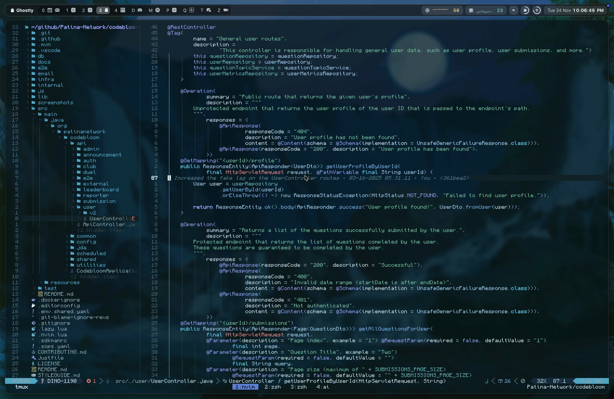

# Dotfiles

This is basically a reproducible `~` directory for all my machines, whether that be work or personal.

[](showcase.mp4)

[Watch the showcase video](showcase.mp4)

Feel free to take whatever config values you may want individually, but if you would like to replace your
`~` file with mine, this is how you would do it:

1. Run these commands:

   ```bash
    /bin/bash -c "$(curl -fsSL https://raw.githubusercontent.com/tahminator/dotfiles/main/init.sh)"
   ```
